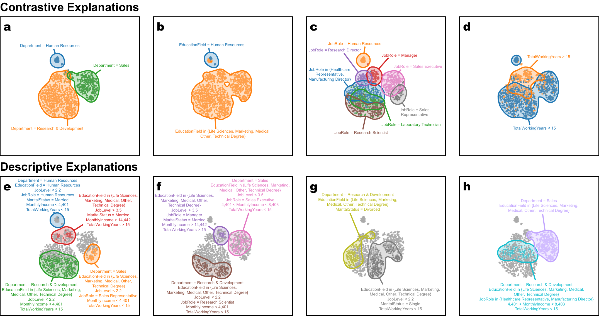

# VERA: Paper Source and Supplementary Material



This repository contains the LaTeX source and supplementary material for the paper **"VERA: Generating Visual Explanations of Two-Dimensional Embeddings via Region Annotation."** It accompanies the open-source Python implementation of VERA in the [`vera`](https://github.com/pavlin-policar/vera) repository.

## Overview

VERA is a method for automatically generating static visual explanations of two-dimensional embeddings produced by techniques such as t-SNE and UMAP. Instead of requiring analysts to manually inspect clusters, transitions, and outliers one feature at a time, VERA identifies informative regions in the embedding and links them to human-interpretable feature values.

The goal is to provide a fast, high-level summary of what an embedding shows. VERA produces both contrastive explanations, which show how feature values vary across the embedding space, and descriptive explanations, which characterize individual regions. In the paper, we show that these generated explanations can support common embedding-interpretation tasks with comparable accuracy to an interactive analysis workflow while requiring substantially less user effort.

## Repository contents

```text
tvcg-embedding-annotation/
├── 2026-tvcg-resubmission-1/      # Current manuscript source
├── bookworm/                      # Synthetic book-purchase example data
├── supplement-data/               # Shared dataset downloader for supplementary studies
├── parameter-study/               # Parameter sensitivity study for VERA
├── region-method-comparison/      # KDE-versus-rangeset comparison
├── purity-indication-comparison/  # Purity-based visual emphasis comparison
├── user-study/                    # User-study materials
└── orange-workflow-examples/      # Orange baseline workflows and screenshots
```

The main paper source lives in `2026-tvcg-resubmission-1/`. The remaining directories provide supplementary material, replication resources, and reviewer-facing evidence for the methodological choices and evaluation described in the manuscript.

## User study

The complete user-study materials, in the form participants saw them, are in [`user-study/`](user-study/): the tool introductions, the six quizzes with the VERA explanations shown for each data set, the tool surveys, and the final comparative survey. Its README describes the study design and the order in which each group saw the materials.

## Setup

From the repository root, create an environment and install the shared supplementary dependencies:

```bash
python -m venv .venv
source .venv/bin/activate
pip install -r requirements.txt
```

Then download the eight shared datasets used by the supplementary studies:

```bash
python supplement-data/download_data.py
```

The datasets are stored in `supplement-data/data/` and reused by all supplementary studies and comparisons.

## Run the studies

Parameter sensitivity study:

```bash
python parameter-study/run_parameter_study.py parameter-study/config.json
```

Region-method comparison:

```bash
python region-method-comparison/run_region_method_comparison.py region-method-comparison/config.json
```

Purity-indication comparison:

```bash
python purity-indication-comparison/run_purity_indication_comparison.py purity-indication-comparison/config.json
```

These supplementary studies and comparisons document several important methodological aspects of VERA, in particular:

- robustness of VERA to parameter choices
- practical guidance for default settings
- positioning of VERA relative to alternative region-construction backends such as rangesets
- effect of purity-based visual emphasis in the final plotted explanations

Additional details, study outputs, and supporting materials are documented in:

- `bookworm/`
- `parameter-study/README.md`
- `region-method-comparison/README.md`
- `purity-indication-comparison/README.md`
- `supplement-data/README.md`
- `user-study/README.md`
- `orange-workflow-examples/README.md`

