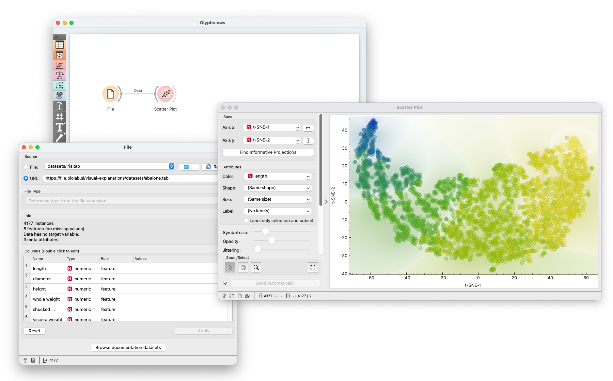
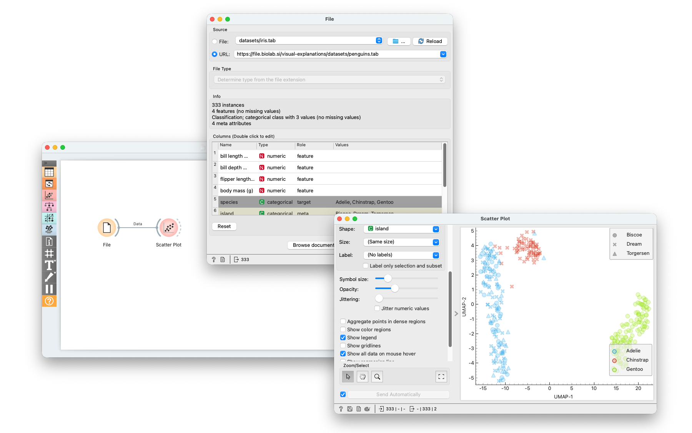
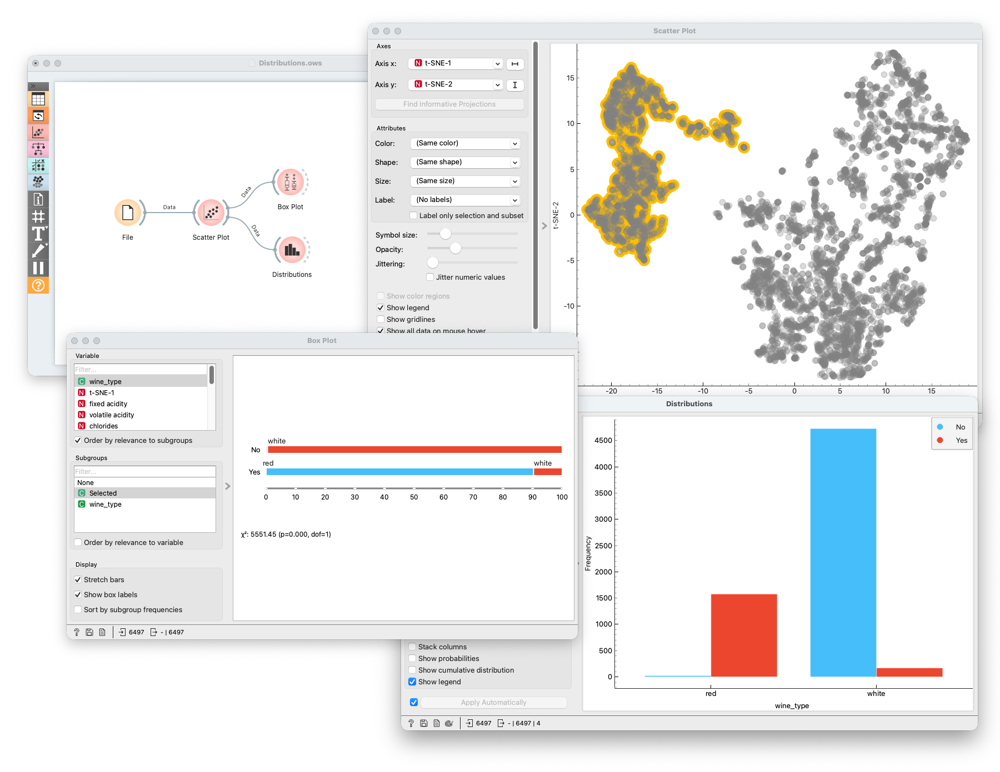
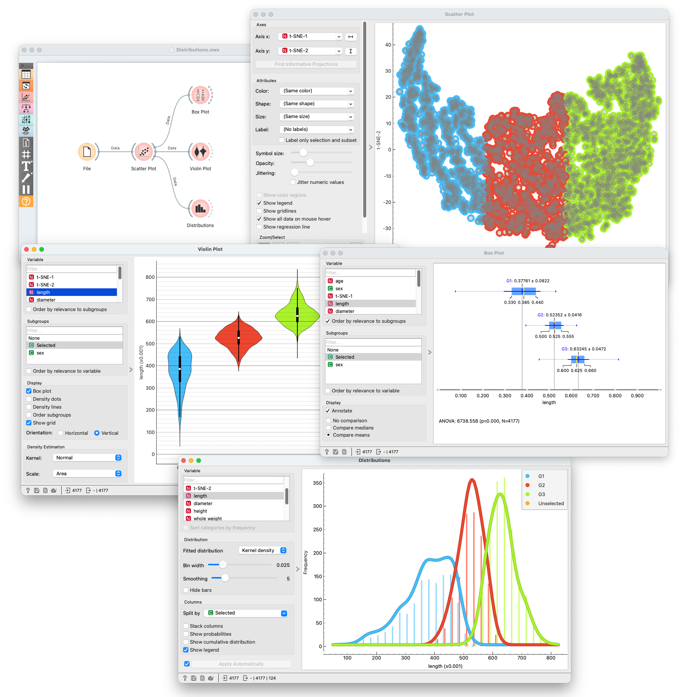
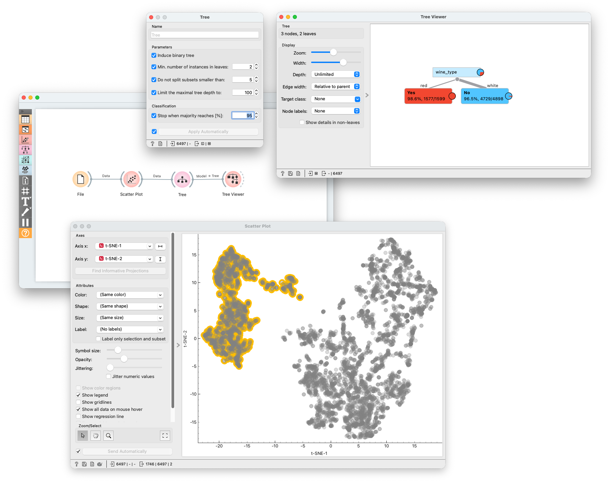
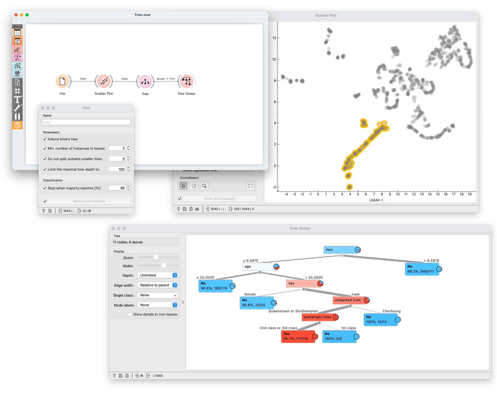
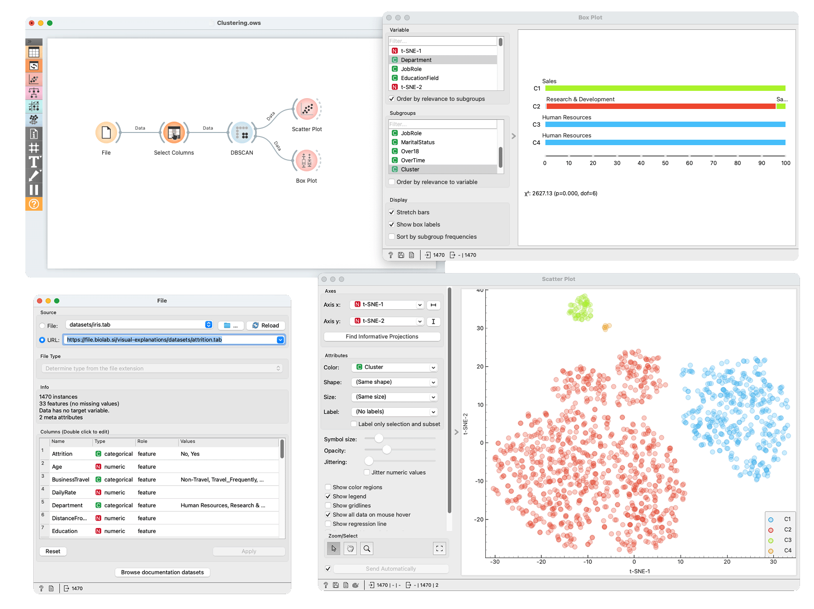
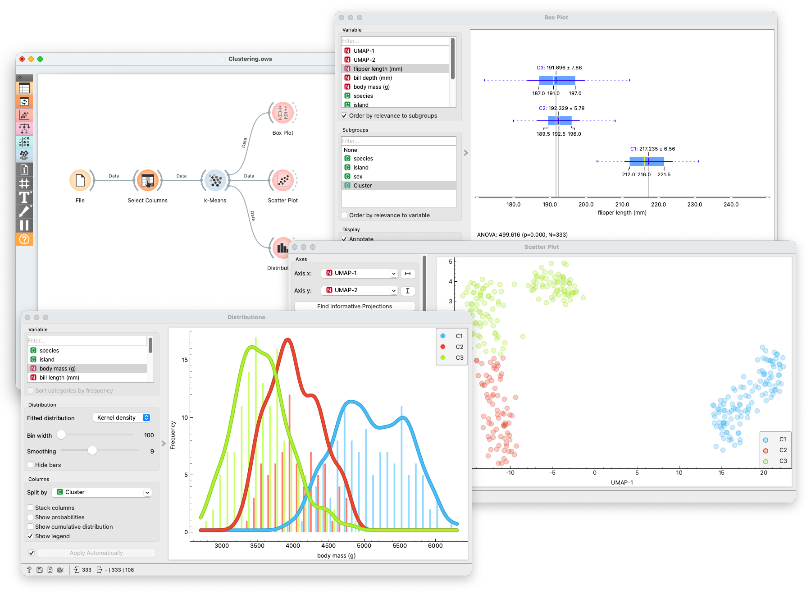

# Orange Workflow Examples

This directory contains the Orange workflows and screenshots that accompany the paper.

**[Orange](https://orangedatamining.com)** is a visual programming toolkit for data mining and exploratory data analysis. Although it is not specifically designed for embedding interpretation, it provides interactive brushing, linked views, and a broad collection of visualization and modeling widgets, making it a convenient platform for exploring two-dimensional embeddings.

In particular, the examples in this directory connect directly to the following point made in the paper:

> Many related approaches based on feature distribution plots and discriminative models can be easily reproduced in Orange using only a handful of widgets. We provide several example workflows in the supplementary materials.

This directory is that supplementary material. Several of the workflows below closely mirror interaction patterns proposed in prior work; where appropriate, we point to representative papers directly in the corresponding workflow descriptions. These citations are intended as illustrative examples rather than a comprehensive survey of related methods.

## What is included

- [workflows/Glyphs.ows](workflows/Glyphs.ows): simple glyph-coloring and glyph-shape workflow
- [workflows/Distributions.ows](workflows/Distributions.ows): workflow based on feature distribution plots
- [workflows/Tree.ows](workflows/Tree.ows): discriminative-model workflow based on a decision tree
- [workflows/Clustering.ows](workflows/Clustering.ows): cluster-oriented workflow for characterizing embedding regions

## How these workflows relate to the paper

These workflows reproduce several commonly used interaction patterns for explaining embeddings, including questions such as:

- *What makes this cluster different from the remaining clusters?*
- *What characterizes the samples in this cluster?*
- *Do you notice any trend along this region?*

The Orange workflows below illustrate how these common embedding-explanation patterns can be reproduced with a small number of standard Orange widgets. In all examples, the two-dimensional embedding is precomputed and included in the data file. Although the embeddings could also be constructed inside Orange, we provide them in advance to make the workflows easier to reproduce.

## Workflow 1: Glyph coloring and glyph shape

This is the simplest workflow and reproduces a common baseline interaction: directly encoding feature values in the embedding through visual channels. In Orange, the **Scatter Plot** widget can color points by one variable and vary their glyph shape by another, making it easy to inspect where different categories occur in the embedding.

The workflow uses:

- `File`
- `Scatter Plot`

This setup is useful for quickly inspecting how categorical variables align with the embedding geometry and for identifying coarse cluster structure, overlap, and separation. However, the user must still go through the variables one by one to determine which ones exhibit interesting structure.

*We first show a simple view in which color is used to encode a numeric variable, revealing a transition from low to high values across the embedding.*

*We can also visualize two categorical variables by encoding shape and color. In this example, we use the shape to encode penguin islands and the color to encode the penguin species.*

## Workflow 2: Feature distribution plots

Feature distribution plots are among the most common visualizations for investigating embedding structure. In Orange, a user selects a region in the embedding in the **Scatter Plot** widget, and Orange immediately propagates the selected subset to linked distribution views. This workflow is closely related to prior interactive approaches for exploring relationships and structure in low-dimensional embeddings and to manual-selection-based analysis workflows [[3]](#references) [[4]](#references) [[6]](#references).

The workflow uses:

- `File`
- `Scatter Plot`
- `Box Plot`
- `Violin Plot`
- `Distributions`

This setup is well suited for comparing one selected cluster or trajectory segment against the rest of the data and for answering questions such as *what characterizes the selected samples?*

*After loading the data, the user selects a group of points of interest. Their characteristics are immediately reflected in the linked box plot and distribution view. Note that Orange sorts the variables by their relevance to the selection, prioritizing features with the largest differences for the selected points.*

*Orange also supports multi-group selections. In this example, the user selects three groups of points. We show the distribution of a numeric variable using a box plot, distribution plot, and violin plot. Together, these views reveal a clear increasing trend across the three selected groups.*

## Workflow 3: Discriminative model

Orange also includes a suite of discriminative models that can be used to investigate what makes one group different from another.
Here, we reproduce a workflow very similar to IXVC, introduced by Bibal et al., which uses a tree learner and tree viewer to explain visual clusters in dimensionality reduction embeddings [[1]](#references).
After selecting a subset of points in the embedding, the selected data are passed to a **Tree** learner and visualized in **Tree Viewer**.

The workflow uses:

- `File`
- `Scatter Plot`
- `Tree`
- `Tree Viewer`

This provides a compact rule-based description of the selected region and is useful for questions of the form *which features best distinguish this cluster from the rest?*

*In this example, the user selects a group of points and constructs a decision tree based on that selection. The user then inspects the resulting tree. In this instance, the tree is quite simple, and the selection can be classified by splitting on a single variable.*

*In many instances, the resulting tree is not quite so simple. This example shows a more complex tree.*

## Workflow 4: Cluster-oriented exploration

This workflow shows a commonly used approach in which the two-dimensional embedding is first segmented using a clustering method, after which the resulting clusters are explained. This cluster-first pattern is closely related to prior explanation and guided visual clustering approaches [[2]](#references) [[4]](#references) [[5]](#references) [[6]](#references).

The workflow uses:

- `File`
- `Select Columns`
- `DBSCAN` or `k-Means`
- `Scatter Plot`
- `Box Plot`

This is useful when the analyst wants Orange to propose candidate groups first and then interactively inspect how the discovered clusters differ in terms of the original features.

*In this example, we use the DBSCAN clustering algorithm to determine clusters. Orange provides an easy, interactive way to adjust parameter values, allowing users fine control over the resulting clustering. We then inspect the clustering result in the Scatter Plot widget and examine the most informative features in a box plot.*

*In this example, we use the k-means clustering algorithm to define clusters and show the distributions of a numeric feature across clusters.*

## Relation to the supplementary materials

These workflows complement the study materials in [../user-study/README.md](../user-study/README.md) and the participant instructions in [../user-study/orange-introduction.md](../user-study/orange-introduction.md).

Together, they document the Orange-based interaction patterns described in the paper:

- They show how standard Orange widgets can be combined to inspect clusters, trends, and separating features.
- They provide concrete examples of linked-view, distribution-based, model-based, and cluster-oriented embedding exploration.
- They serve as illustrative supplementary material for the Orange baseline used in the paper.

These examples are therefore not separate from the paper's methodology; they are concrete reproductions of the interactive embedding-explanation workflows discussed there.

## References

[1] Adrien Bibal, Antoine Clarinval, Bruno Dumas, and Benoît Frénay. *IXVC: An interactive pipeline for explaining visual clusters in dimensionality reduction visualizations with decision trees*. Array 11, 2021.

[2] Xander Vankwikelberge et al. *ExClus: Explainable Clustering on Low-dimensional Data Representations*. arXiv:2111.03168, 2021.

[3] K. Eckelt et al., "Visual Exploration of Relationships and Structure in Low-Dimensional Embeddings," in *IEEE Transactions on Visualization and Computer Graphics*, vol. 29, no. 7, pp. 3312-3326, 1 July 2023, doi: 10.1109/TVCG.2022.3156760.

[4] M. Cavallo and C. Demiralp, "Clustrophile 2: Guided Visual Clustering Analysis," in *IEEE Transactions on Visualization & Computer Graphics*, vol. 25, no. 01, pp. 267-276, Jan. 2019, doi: 10.1109/TVCG.2018.2864477.

[5] B. C. Kwon et al., "Clustervision: Visual Supervision of Unsupervised Clustering," in *IEEE Transactions on Visualization and Computer Graphics*, vol. 24, no. 1, pp. 142-151, Jan. 2018, doi: 10.1109/TVCG.2017.2745085.

[6] L. Pagliosa, P. Pagliosa and L. G. Nonato, "Understanding Attribute Variability in Multidimensional Projections," *2016 29th SIBGRAPI Conference on Graphics, Patterns and Images (SIBGRAPI)*, Sao Paulo, Brazil, 2016, pp. 297-304, doi: 10.1109/SIBGRAPI.2016.048.

