# Region Construction — abalone

This page shows how the region construction parameters affect the extracted region annotations. Each figure shows the raw region annotations for all features — one panel per feature (or feature group after post-hoc merging).

## Default parameters

| Parameter | Default value |
|---|---|
| Number of bins | `5` |
| Contour level | `0.25` |
| Bandwidth scale factor | `1.0` |
| Merge overlap threshold | `0.8` |

## Default region annotations

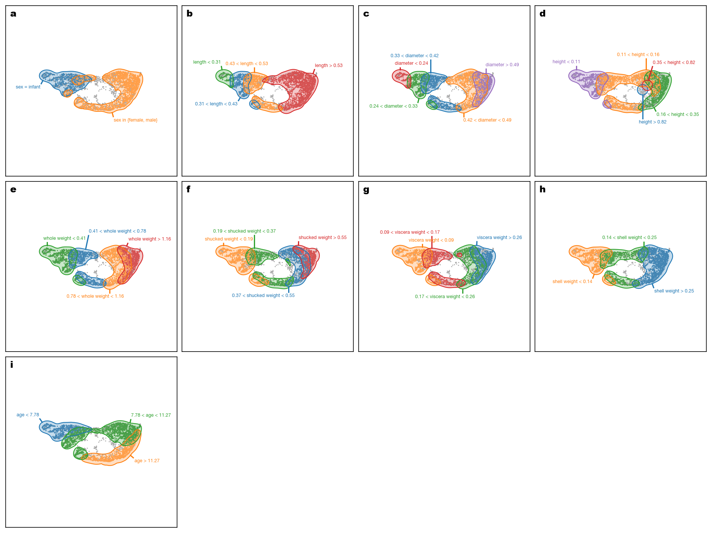

## Varying: Number of bins

Default value: `5`. All other parameters held at their defaults.

| Number of bins | Region annotations |
|---|---|
| `3` | 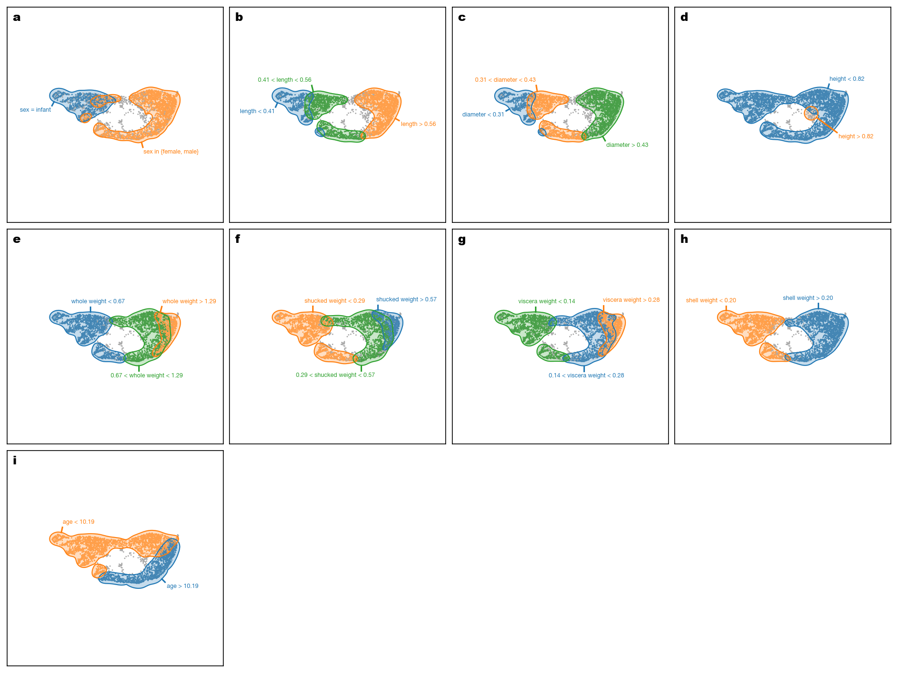 |
| `5` **(default)** |  |
| `10` | 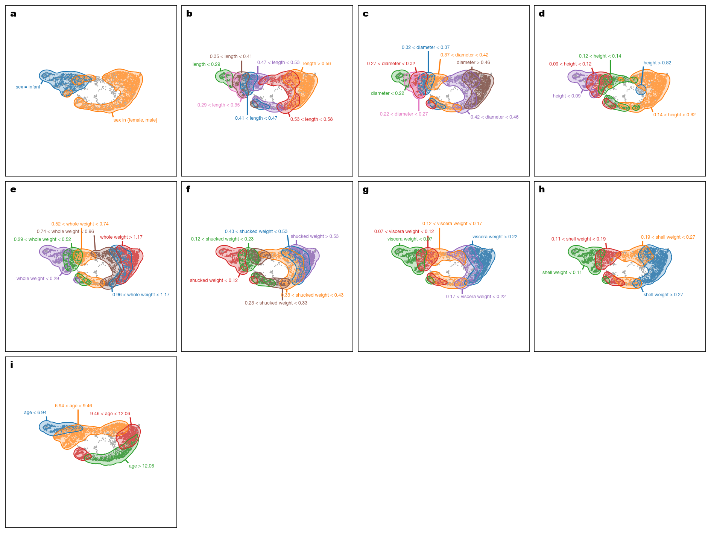 |

## Varying: Contour level

Default value: `0.25`. All other parameters held at their defaults.

| Contour level | Region annotations |
|---|---|
| `0.1` | 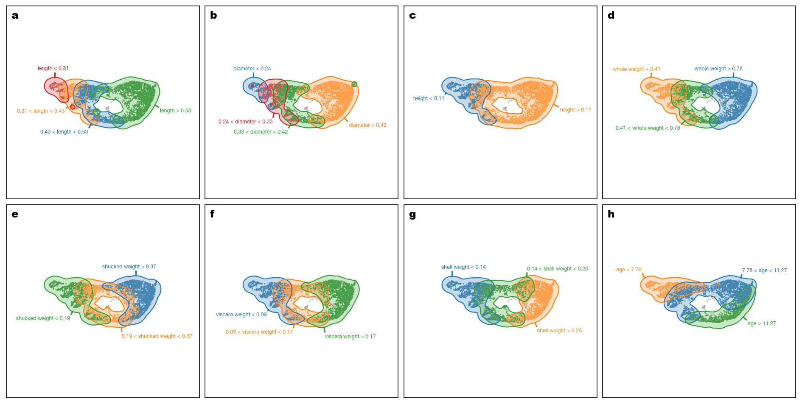 |
| `0.25` **(default)** |  |
| `0.5` | 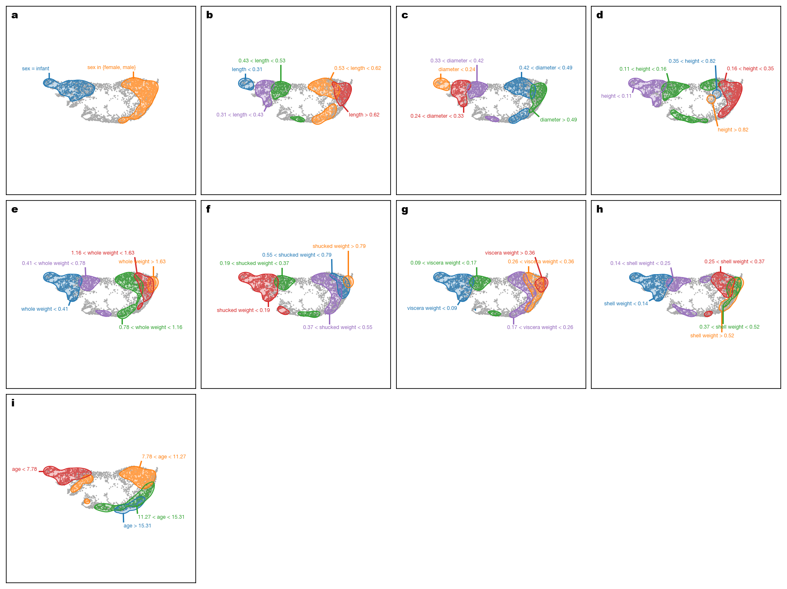 |

## Varying: Bandwidth scale factor

Default value: `1.0`. All other parameters held at their defaults.

| Bandwidth scale factor | Region annotations |
|---|---|
| `0.5` | 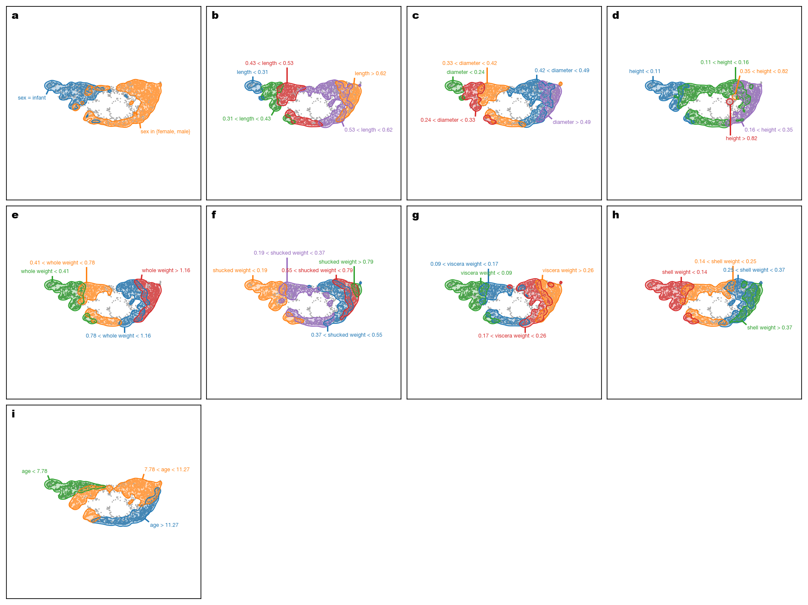 |
| `1` **(default)** |  |
| `2` | 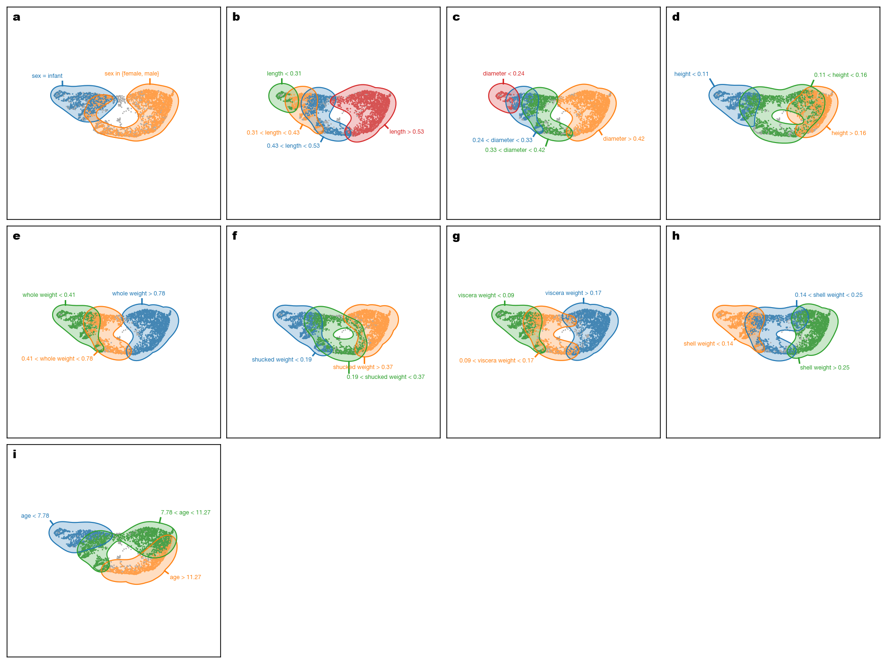 |

## Varying: Merge overlap threshold

Default value: `0.8`. All other parameters held at their defaults.

| Merge overlap threshold | Region annotations |
|---|---|
| `0.5` | 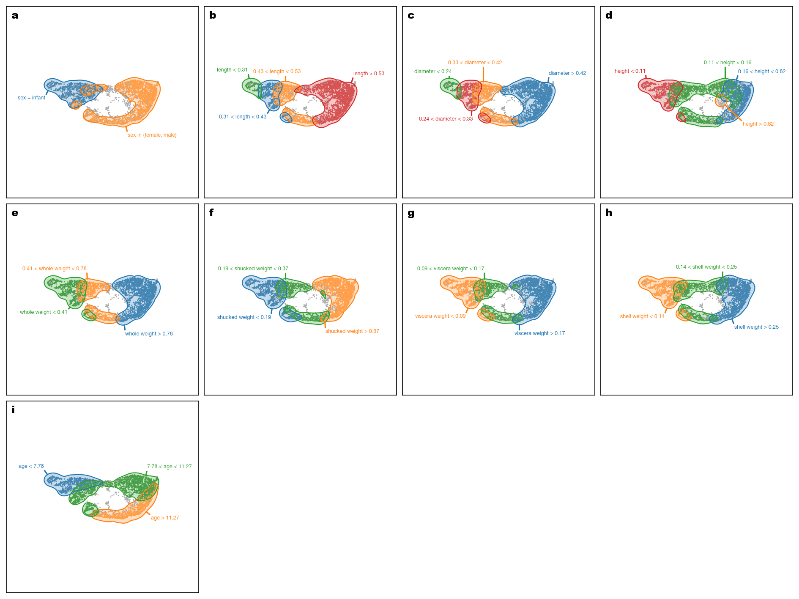 |
| `0.7` | 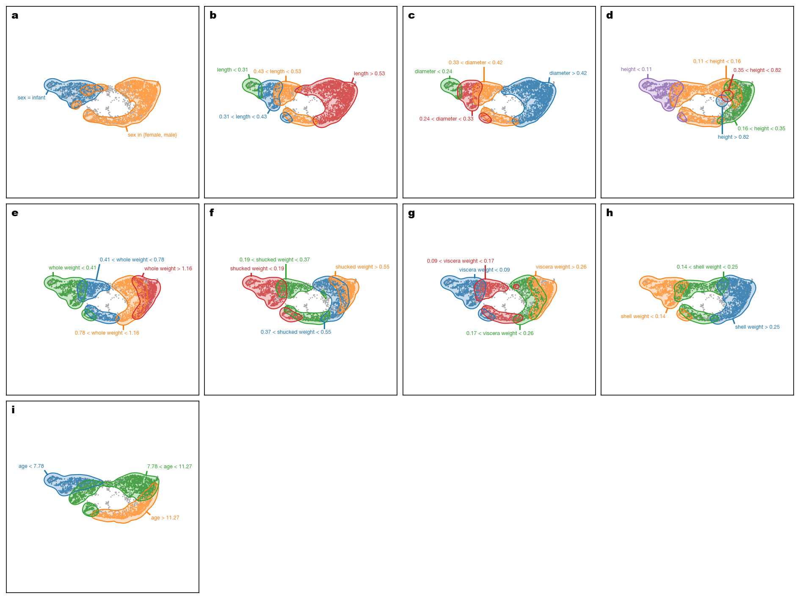 |
| `0.8` **(default)** |  |
| `0.9` | 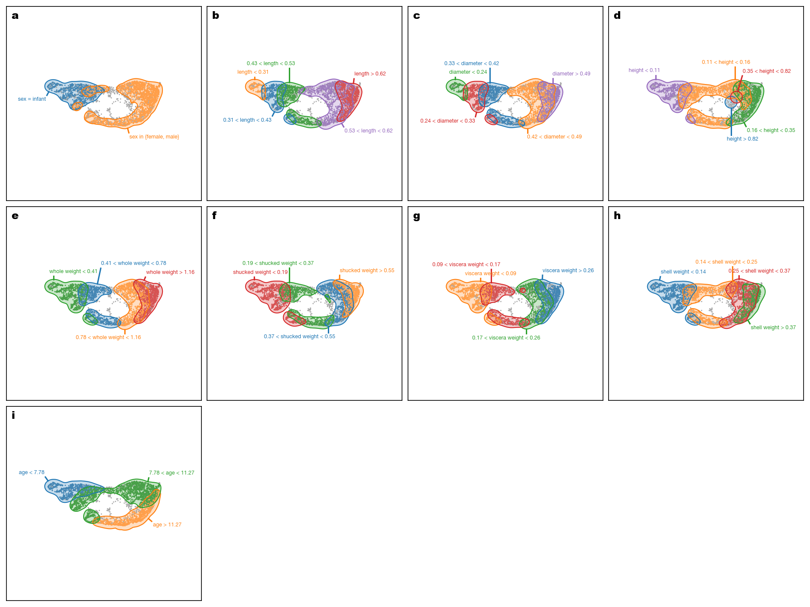 |
| `0.95` | 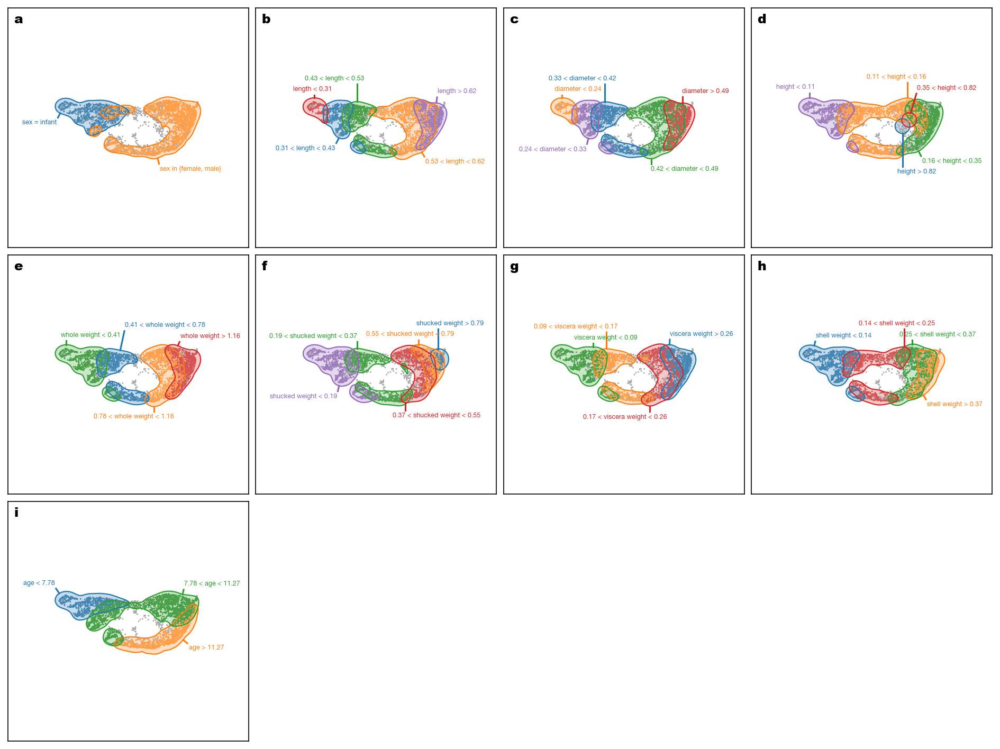 |
