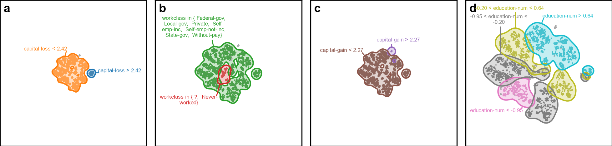
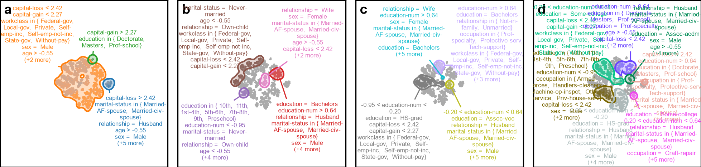
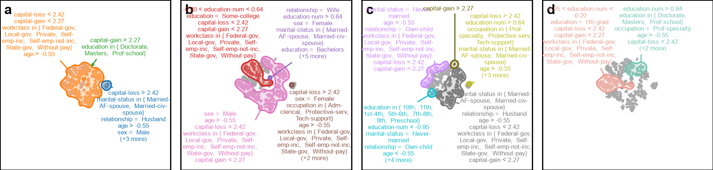
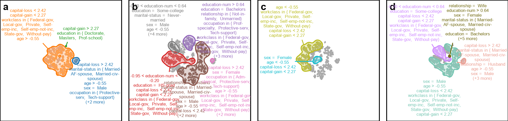
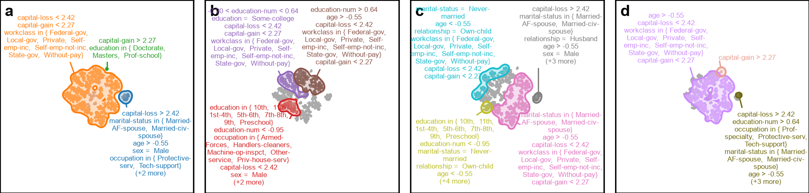
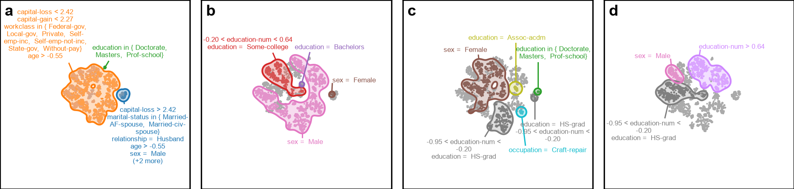
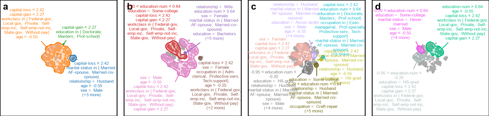
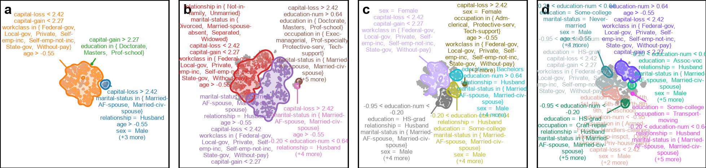
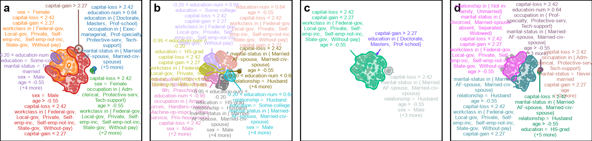

# Explanation Construction — adult

This page shows how explanation-construction parameters affect the final contrastive and descriptive explanations generated from the default region annotations.

## Default region-construction parameters

| Parameter | Default value |
|---|---|
| Number of bins | `5` |
| Contour level | `0.25` |
| Bandwidth scale factor | `1.0` |
| Merge overlap threshold | `0.8` |
| Sample size | `5000` |
| Random state | `0` |

## Contrastive defaults

| Parameter | Default value |
|---|---|
| Merge threshold | `0.95` |

## Contrastive: varying Merge threshold

Default value: `0.95`. All other contrastive parameters held at their defaults.

| Merge threshold | Explanation |
|---|---|
| `0.8` |  |
| `0.9` |  |
| `0.95` **(default)** |  |
| `0.99` |  |

## Descriptive defaults

| Parameter | Default value |
|---|---|
| Merge threshold | `0.8` |
| Enrich with background | `True` |
| Max overlap | `0.0` |

## Descriptive: varying Merge threshold

Default value: `0.8`. All other descriptive parameters held at their defaults.

| Merge threshold | Explanation |
|---|---|
| `0.5` |  |
| `0.7` |  |
| `0.8` **(default)** |  |
| `0.9` |  |
| `0.95` |  |

## Descriptive: varying Enrich with background

Default value: `True`. All other descriptive parameters held at their defaults.

| Enrich with background | Explanation |
|---|---|
| `True` **(default)** |  |
| `False` |  |

## Descriptive: varying Max overlap

Default value: `0.0`. All other descriptive parameters held at their defaults.

| Max overlap | Explanation |
|---|---|
| `0.0` **(default)** |  |
| `0.1` |  |
| `0.25` |  |
