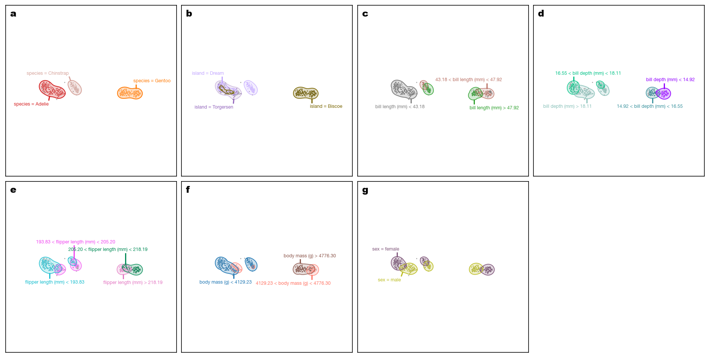
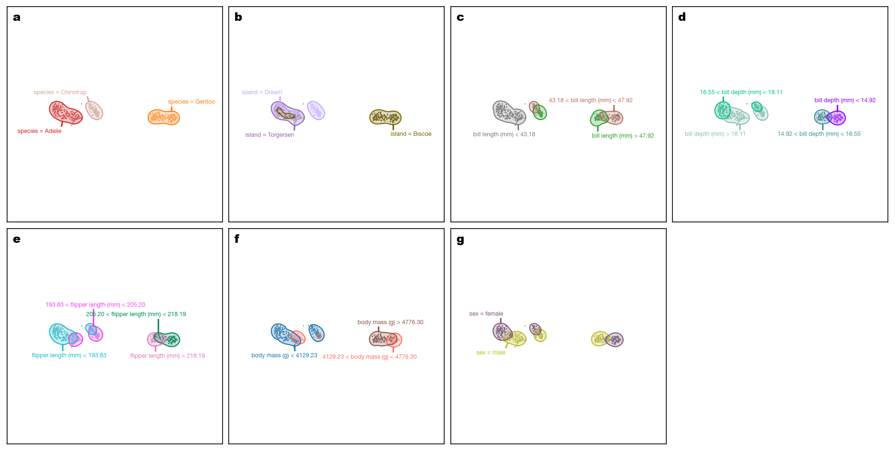
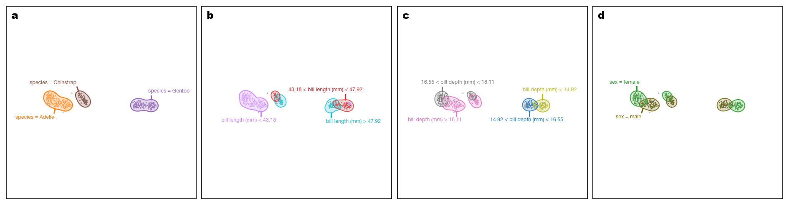
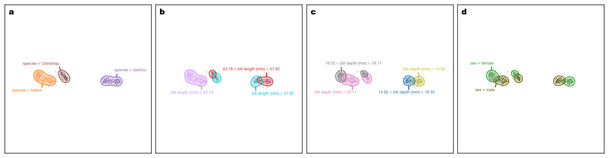
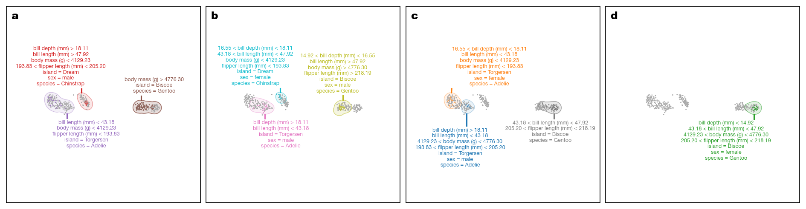
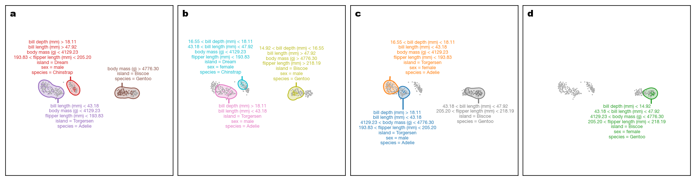

# Purity Indication Comparison — Penguins

This page compares the default final VERA outputs with opacity-based purity indication disabled and enabled. The extracted regions and the constructed explanations are the same in both columns; only the rendering changes through the `indicate_purity` plotting flag.

Dataset size: `333` samples. Sampling was not required for this dataset.

## Default region-construction parameters

| Parameter | Value |
|---|---|
| Number of bins | `5` |
| Contour level | `0.25` |
| Bandwidth scale factor | `1.0` |
| Merge overlap threshold | `0.8` |
| Sample size | `5000` |
| Random state | `0` |

## Region annotations

### Purity indicated (`indicate_purity=True`)

### Regular (`indicate_purity=False`)

## Contrastive defaults

| Parameter | Value |
|---|---|
| Merge threshold | `0.95` |

## Contrastive explanations

### Purity indicated (`indicate_purity=True`)

### Regular (`indicate_purity=False`)

## Descriptive defaults

| Parameter | Value |
|---|---|
| Merge threshold | `0.8` |
| Enrich with background | `True` |
| Max overlap | `0.0` |

## Descriptive explanations

### Purity indicated (`indicate_purity=True`)

### Regular (`indicate_purity=False`)

