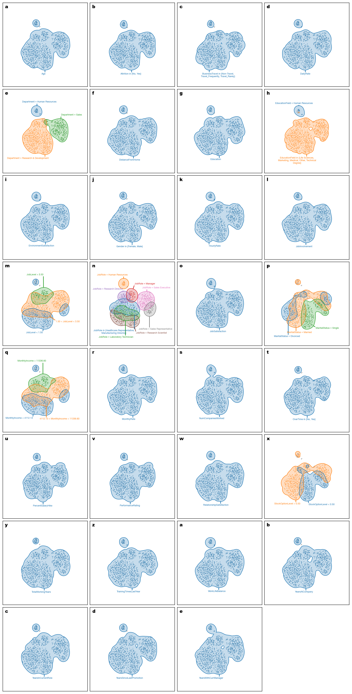
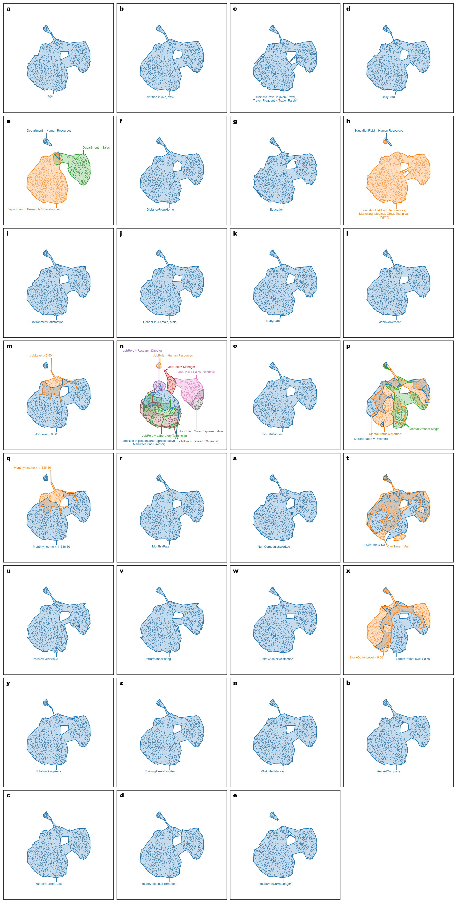

# Region Construction Comparison — attrition

This page compares the raw region annotations produced by the two region-construction backends while keeping the remaining VERA settings fixed.

Dataset size: `1470` samples. Sampling was not required for this dataset.

## Default parameters

| Parameter | Value |
|---|---|
| Number of bins | `5` |
| Contour level | `0.25` |
| Bandwidth scale factor | `1.0` |
| Merge overlap threshold | `0.8` |
| Sample size | `5000` |
| Random state | `0` |

## Region annotations

| Method | Region annotations |
|---|---|
| KDE |  |
| Rangeset |  |
