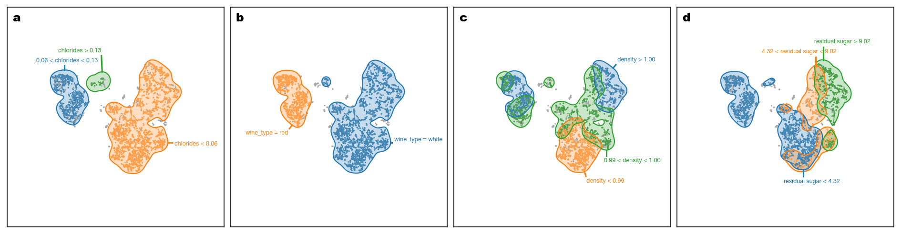
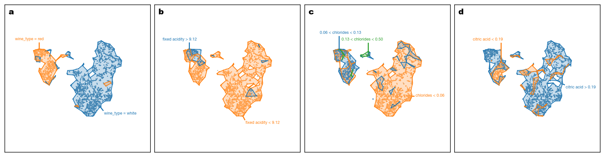
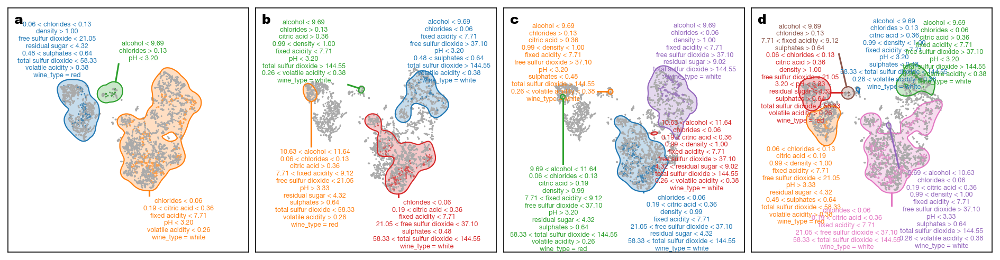
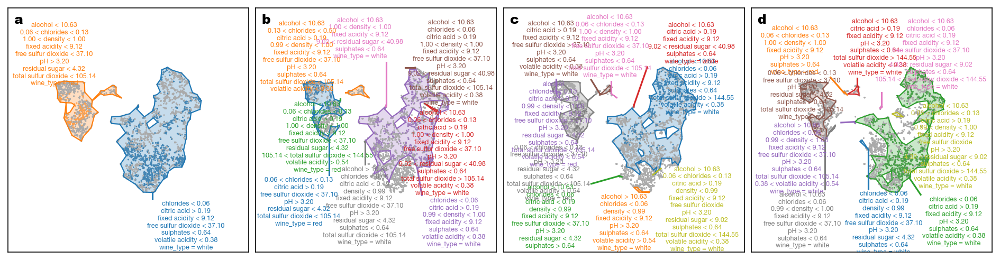

# Explanation Construction Comparison — wine_quality

This page compares the final contrastive and descriptive explanations obtained from different region-construction backends while keeping the remaining explanation settings fixed.

Dataset size: `6497` samples. Because rangesets can be slow on larger datasets, both region-construction backends are evaluated on the same fixed random sample of `5000` points (`random_state=0`). As a result, extracted regions may not cover every point in the full dataset.

## Default region-construction parameters

| Parameter | Value |
|---|---|
| Number of bins | `5` |
| Contour level | `0.25` |
| Bandwidth scale factor | `1.0` |
| Merge overlap threshold | `0.8` |
| Sample size | `5000` |
| Random state | `0` |

## Contrastive defaults

| Parameter | Value |
|---|---|
| Merge threshold | `0.95` |

## Contrastive explanations

| Method | Explanation |
|---|---|
| KDE |  |
| Rangeset |  |

## Descriptive defaults

| Parameter | Value |
|---|---|
| Merge threshold | `0.8` |
| Enrich with background | `True` |
| Max overlap | `0.0` |

## Descriptive explanations

| Method | Explanation |
|---|---|
| KDE |  |
| Rangeset |  |
