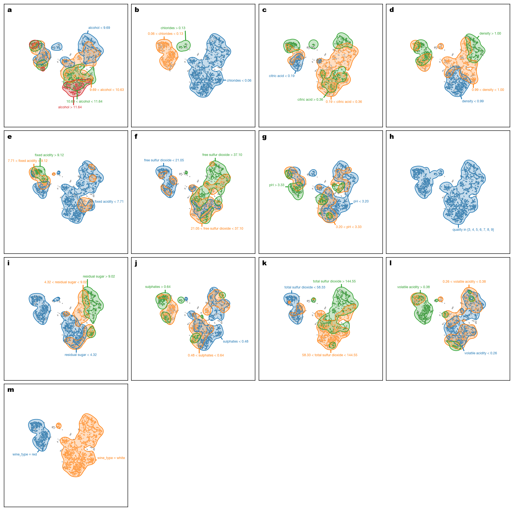
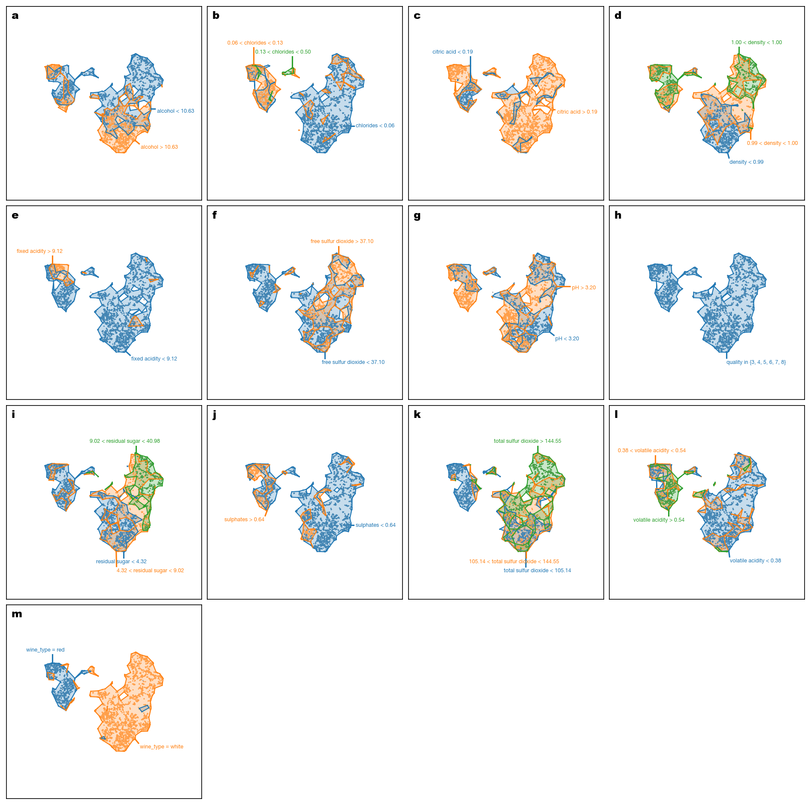

# Region Construction Comparison — wine_quality

This page compares the raw region annotations produced by the two region-construction backends while keeping the remaining VERA settings fixed.

Dataset size: `6497` samples. Because rangesets can be slow on larger datasets, both region-construction backends are evaluated on the same fixed random sample of `5000` points (`random_state=0`). As a result, extracted regions may not cover every point in the full dataset.

## Default parameters

| Parameter | Value |
|---|---|
| Number of bins | `5` |
| Contour level | `0.25` |
| Bandwidth scale factor | `1.0` |
| Merge overlap threshold | `0.8` |
| Sample size | `5000` |
| Random state | `0` |

## Region annotations

| Method | Region annotations |
|---|---|
| KDE |  |
| Rangeset |  |
