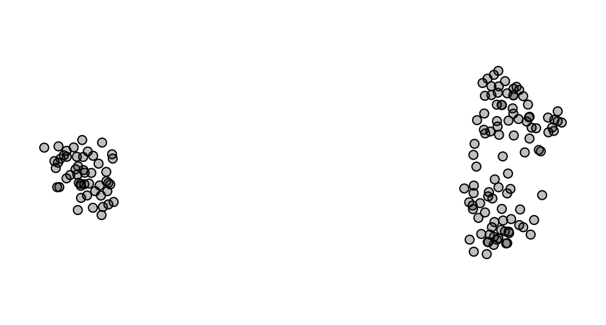
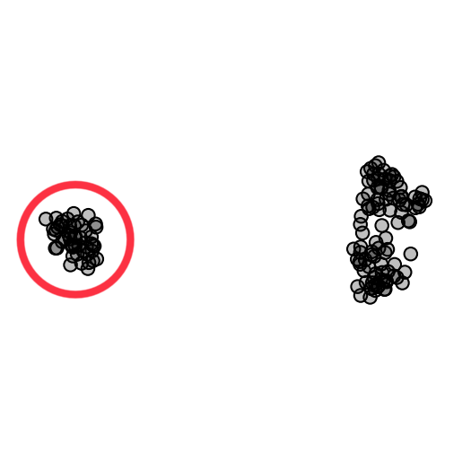
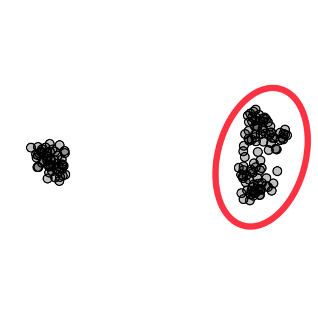

## Iris

The Iris flower dataset from Anderson (1936) is a classic dataset in machine learning. It consists of 150 samples of iris flowers, each belonging to one of three species: iris setosa, iris versicolor, or iris virginica. Each sample contains four pyhsical measurements of the flower, including sepal length, sepal width, petal length, and petal width.

<sup>*Image source: [https://machinelearninghd.com/iris-dataset-uci-machine-learning-repository-project/](https://machinelearninghd.com/iris-dataset-uci-machine-learning-repository-project/)*</sup>

Visualizing four variables is outside the capabilities of human perception, so we resort to dimensionality reduction to see if we can find some interesting structure in the data set. Here, we use the t-SNE algorithm, which produces the following visualization:

Each of the black dots represents one of the 150 flowers. The t-SNE algorithm positions each point so that flowers with similar petal and sepal measurements are placed close to one another.

Looking at the plot, we can see that there are roughly two groups or *clusters* of points. Here, we will try to determine what these clusters correspond to, and if we can distinguish between the iris species based on these measurements alone.

If you are using Orange for interpretation, download the data [here](http://file.biolab.si/visual-explanations/datasets/iris.tab) or paste the following URL into the URL field in the File widget:
```
https://file.biolab.si/visual-explanations/datasets/iris.tab
```


### Questions



**Q1**: Does the circled cluster on the left correspond to any particular species of iris flowers? If so, which?



**Q2**: Does the circled cluster on the right correspond to any particular species of iris flowers? If so, which?

**Q3**: Which of the iris species are more similar to one another?
1. iris setosa - iris virginica
2. iris setosa - iris versicolor
3. iris versicolor - iris virginica

**Q4**: What are the differences between 'iris setosa' and the other two iris species?

**Q5**: What are the differences between 'iris versicolor' and 'iris virginica'?
