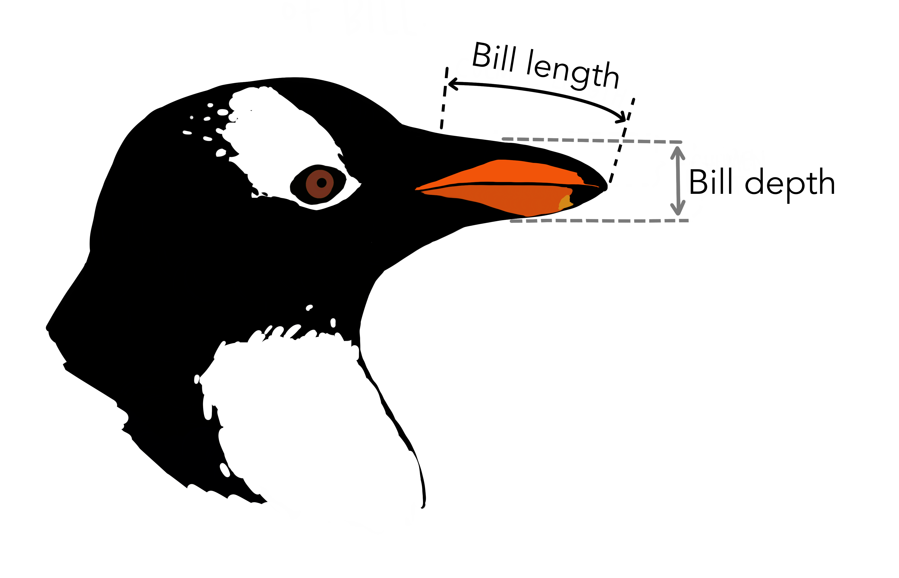
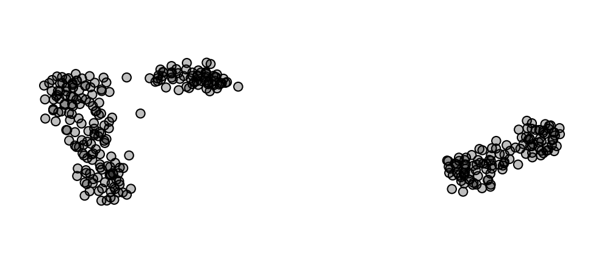
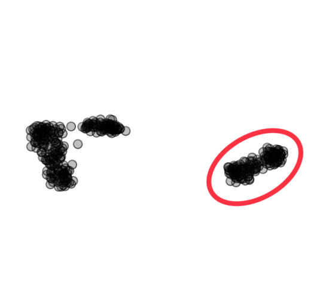
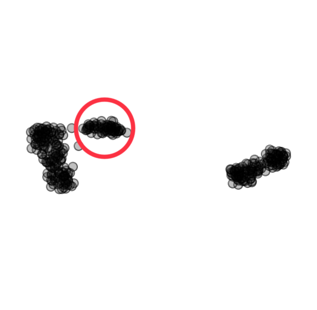
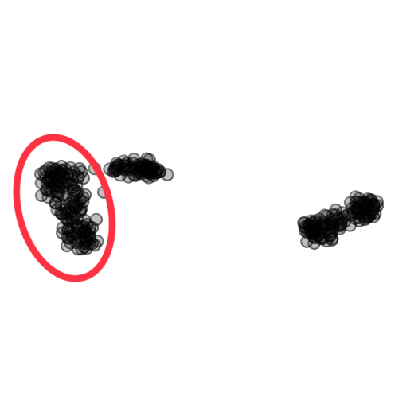

## Penguins

The penguin data set consists of 333 samples of penguin measurements, each penguin belonging to one of three penguin species: Adelie, Chinstrap, or Gentoo. Each sample contains four physical measurements of the penguin, including bill length, bill depth, flipper length, and body mass. Additionally, we are given information on the penguin sex and which island each penguin was found on.

<sup>*Image adapted from: [https://github.com/allisonhorst/palmerpenguins](https://github.com/allisonhorst/palmerpenguins/raw/main/man/figures/culmen_depth.png)*</sup>

Visualizing four variables is outside the capabilities of human perception, so we resort to dimensionality reduction to see if we can find some interesting structure in the data set. Here, we use the t-SNE algorithm, which produces the following visualization:

Each of the black dots represents one of the 333 penguins. The t-SNE algorithm positions each point so that penguins with similar bill, flipper, and mass sepal measurements are placed close to one another.

If you are using Orange for interpretation, download the data [here](http://file.biolab.si/visual-explanations/datasets/penguins.tab) or paste the following URL into the URL field in the File widget:
```
https://file.biolab.si/visual-explanations/datasets/penguins.tab
```


### Questions



**Q1**: Does the circled cluster correspond to any particular species of penguin? If so, which?



**Q2**: Does the circled cluster correspond to any particular species of penguin? If so, which?



**Q3**: Does the circled cluster correspond to any particular species of penguin? If so, which?

**Q4**: Which of the penguin species are more similar to one another?
1. Adelie - Chinstrap
2. Adelie - Gentoo
3. Chinstrap - Gentoo

**Q5**: What are the differences between Gentoo penguins and the other penguin species?

**Q6**: What are the differences between Adelie and Chinstrap penguins?
