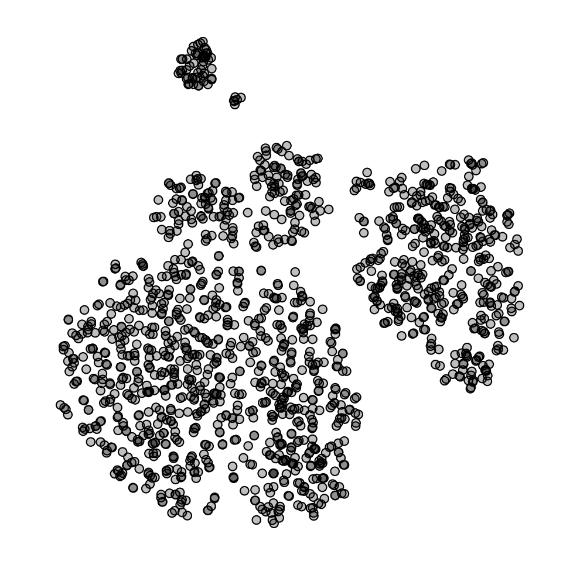
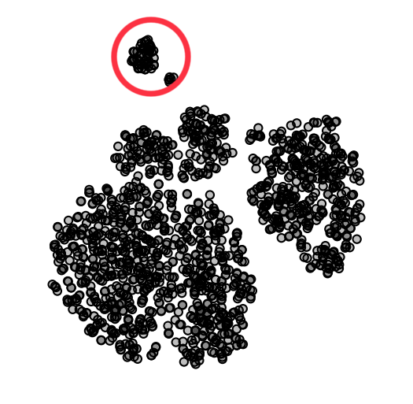
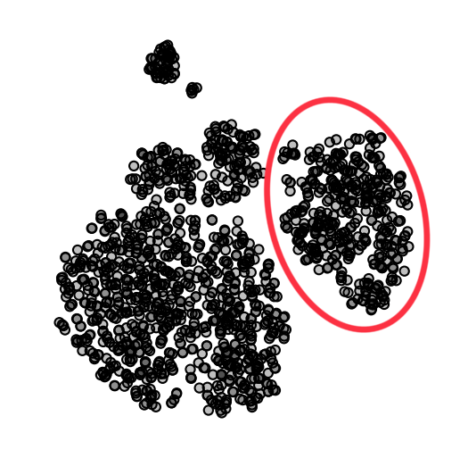
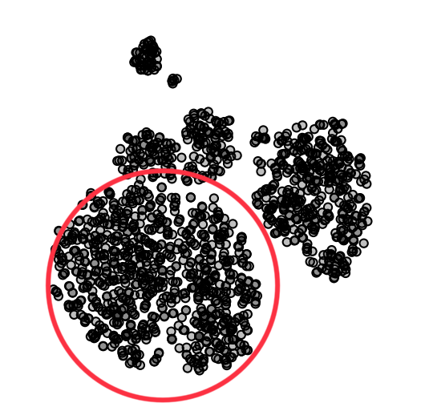
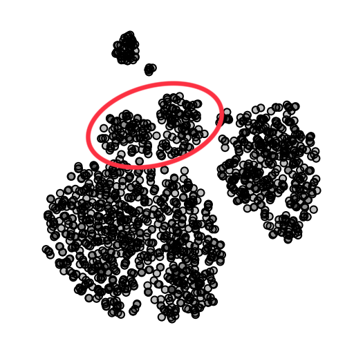
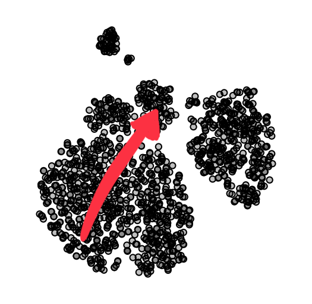

## Employee Attrition

This is a fictional data set created by IBM data scientists, contains information on employees in a particular company. While this data set is typically used for predicting employee attrition, we will here investigate employee patterns and try to determine if any particular groups of employees emerge.



If you are using Orange for interpretation, download the data [here](http://file.biolab.si/visual-explanations/datasets/employee-attrition.tab) or paste the following URL into the URL field in the File widget:
```
https://file.biolab.si/visual-explanations/datasets/attrition.tab
```


### Questions



**Q1**: Which feature shows the most clear separation between samples?



**Q2**:Who are the employees in the circled cluster?




**Q3**: Who are the employees in the circled cluster?




**Q4**: Who are the employees in the circled cluster?




**Q5**: Is there any interesting trend following the arrow to the left? If so, describe which features change and how they change.


**Q6**: Do married individuals get higher monthly salaries?
1. Yes
2. No


**Q7**: Is there any interesting trend following the arrow to the left? If so, describe which features change and how they change.
1. Sales Executive
2. Research Scientist
3. Laboratory Technician
4. Manufacturing Director
5. Healthcare Representative
6. Manager
7. Sales Representative
8. Human Resources
9. Research Director
