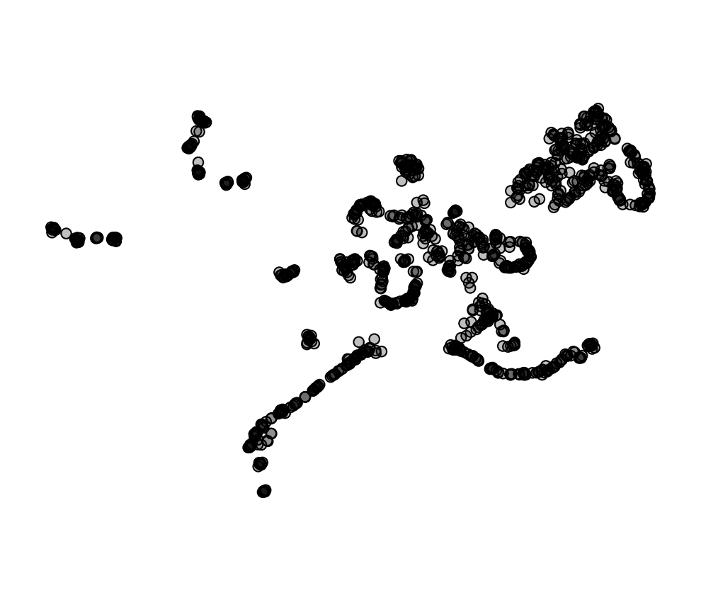
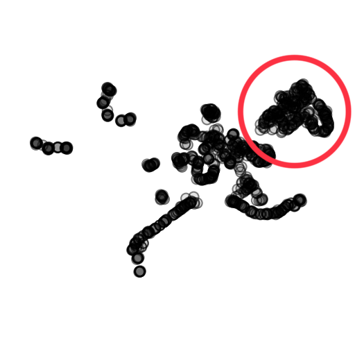
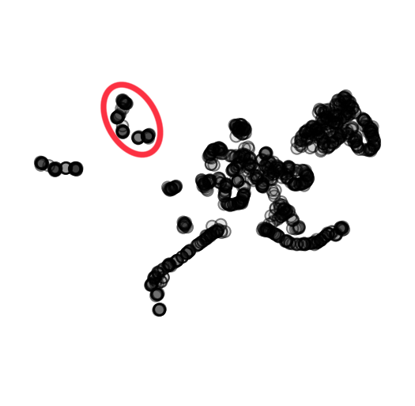
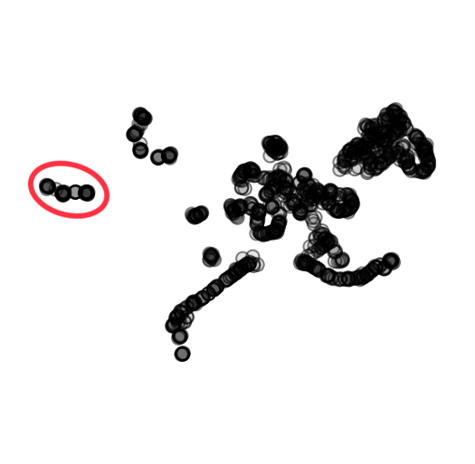
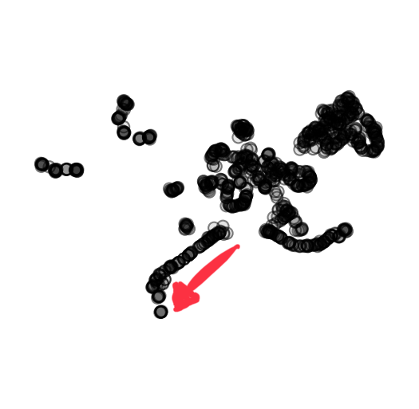

## Titanic

The Titanic data set is another classic machine learning data set containing information about passengers aboard the RMS Titanic, including whether they survived or not. The dataset includes various features such as passenger class, sex, age, number of siblings/spouses aboard, number of parents/children aboard, ticket fare, and cabin number.



If you are using Orange for interpretation, download the data [here](http://file.biolab.si/visual-explanations/datasets/titanic.tab) or paste the following URL into the URL field in the File widget:
```
https://file.biolab.si/visual-explanations/datasets/titanic.tab
```


### Questions

**Q1**: Which feature shows the most clear separation between samples?
1. passenger class
2. sex
3. \# siblings/spouses aboard
4. \# parents/children aboard
5. fare
6. age
7. embarked fromsurvived



**Q2**: Who are the passengers in the circled cluster?



**Q3**: Who are the passengers in the circled cluster?



**Q4**: Who are the passengers in the circled cluster?



**Q5**: Is there any interesting trend following the arrow to the left? If so, describe which features change and how they change.

**Q6**: Who was most likely to survive?
1. Men
2. Women

**Q7**: Were children more likely to survive than adults?
1. Yes
2. No
