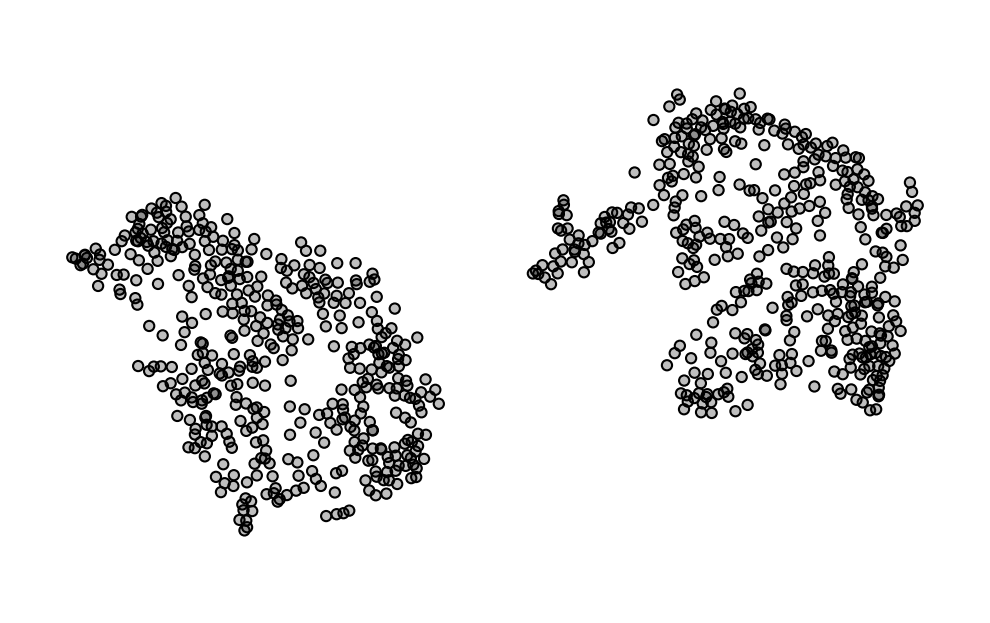
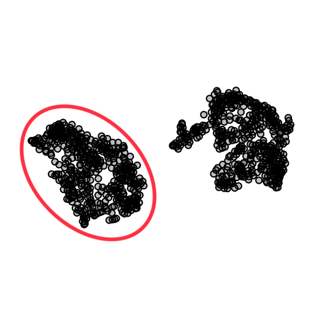
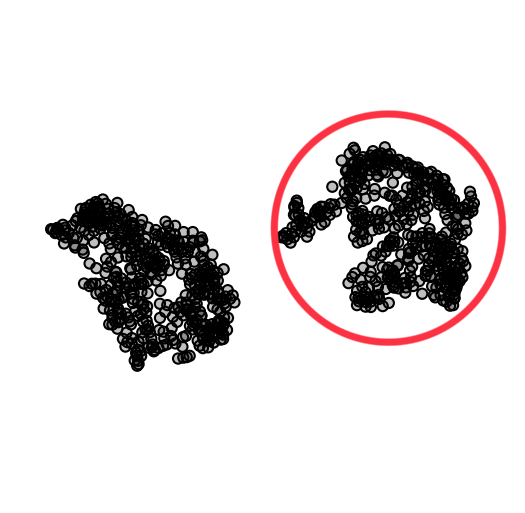
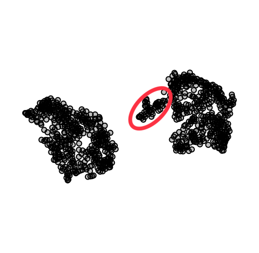

## Raisin

The Raisin dataset contains seven morphological features of everybody's favorite healthy snack -- raisins. The data set contains 900 samples of raising of the Kecimen and Besni variety.



If you are using Orange for interpretation, download the data [here](http://file.biolab.si/visual-explanations/datasets/raisin.tab) or paste the following URL into the URL field in the File widget:
```
https://file.biolab.si/visual-explanations/datasets/raisin.tab
```

### Questions



**Q1**: What features are characteristic of the towns in the circled cluster?



**Q2**: What features are characteristic of the towns in the circled cluster?



**Q3**: What makes the circled cluster different from the one in the previous quesiton?
