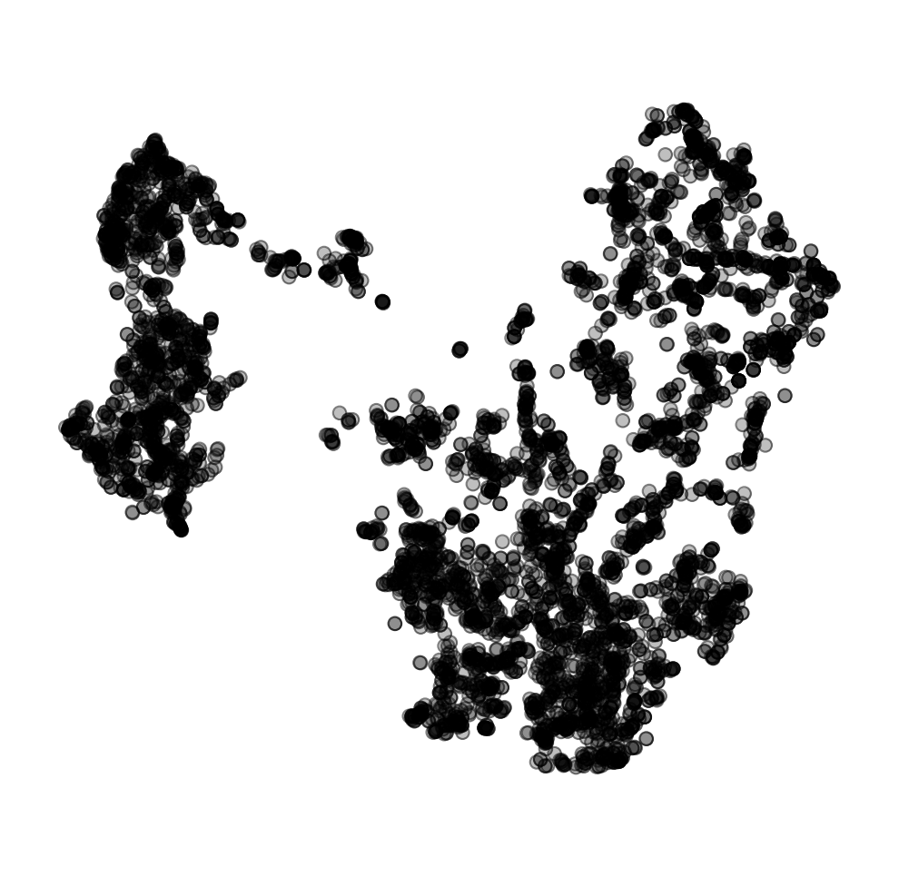
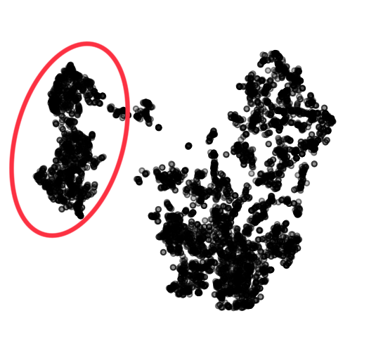
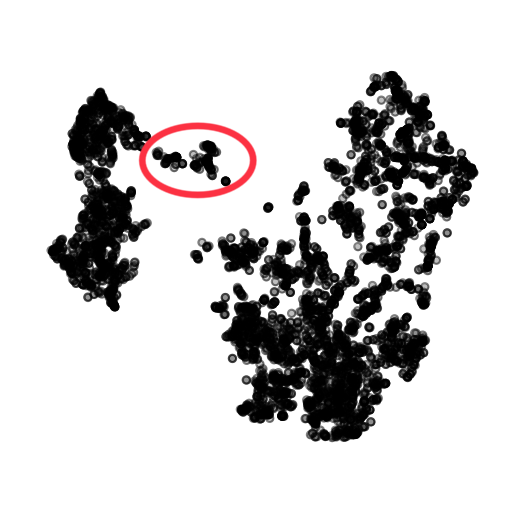
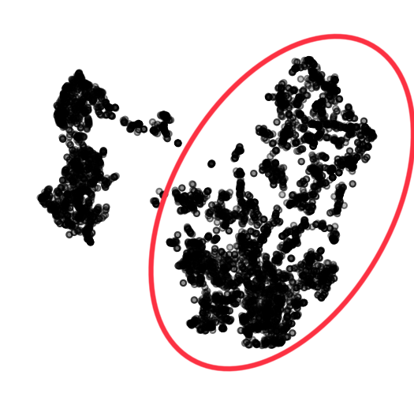
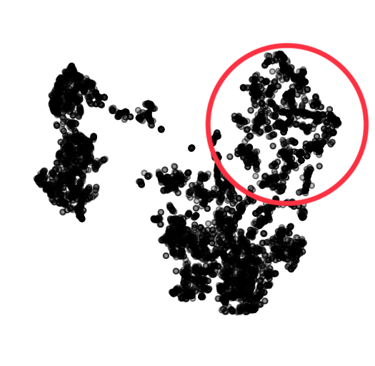

## Wine Quality

The Wine Quality dataset contains data on physicochemical properties of red and white wine samples, as well as their quality ratings. The dataset includes various features such as acidity levels, alcohol content, density, pH, and more. There are two separate datasets for red and white wines, each with quality ratings ranging from 3 to 8. These quality ratings are typically based on sensory evaluations.



If you are using Orange for interpretation, download the data [here](http://file.biolab.si/visual-explanations/datasets/wine-quality.tab) or paste the following URL into the URL field in the File widget:
```
https://file.biolab.si/visual-explanations/datasets/wine.tab
```

### Questions



**Q1**: What features are characteristic of the wines in the circled cluster?



**Q2**: What features are characteristic of the wines in the circled cluster?



**Q3**: What features are characteristic of the wines in the circled cluster?



**Q4**: What makes the circled cluster different from the one in the previous quesiton?
